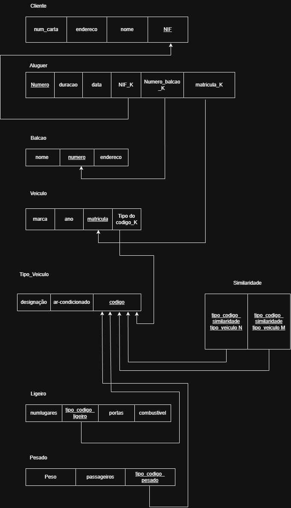
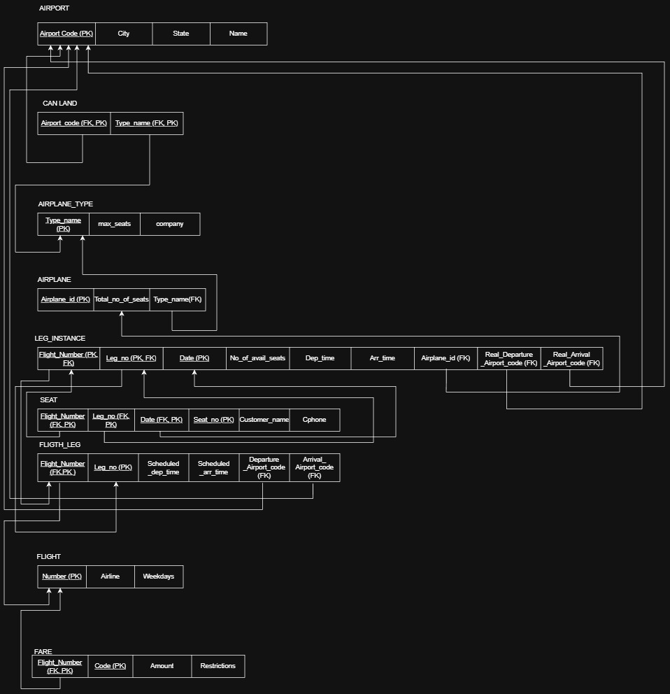
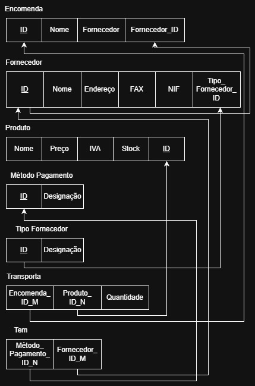
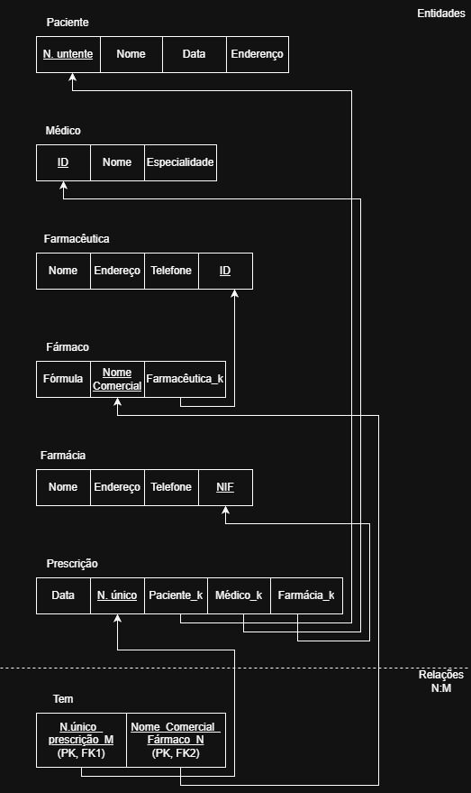
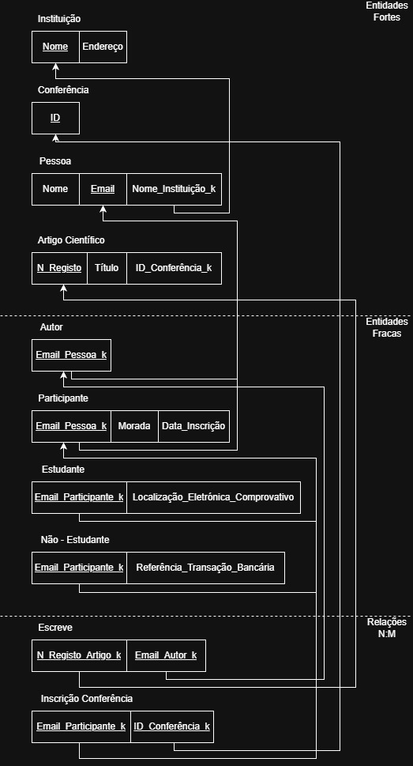
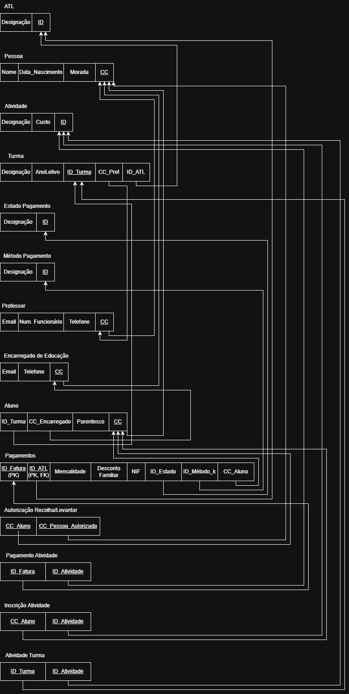

# BD: Guião 3

## ​Problema 3.1

### *a)*

```
Clientes: 

    Identificados inicialmente pelo NIF e com um número único de cliente, podem efetuar múltiplos alugueres.

Alugueres e Balcões: 

    Cada aluguer é realizado num balcão específico, o qual é identificado por um número.

Veículos: 

    Identificados pela matrícula, pertencem a um tipo específico (através de um código) que pode ser ligeiro ou pesado.

Similaridade: 

    Veículos que partilham a mesma categoria possuem um grau de similaridade entre si.

Esquema de relação:

- Cliente = NIF,num_carta , endereço,nome
- Aluguer = Número, Data, Duração
- Balcão = Número, Endereço, Nome
- Veículo = marca , ano , matricula
- Tipo de Veículo = Designação , Ar-Condicionado , Código 
- Ligeiro = NumLugares, Portas, Combustível
- Pesado = Peso, Passageiros
- Similaridade de Tipo de Veículo = Tipo de Código N, Tipo de Código M

```

### *b)*

```

Chaves candidatas:
- Cliente: NIF, Num_Carta
- Aluguer: Número
- Balcão: Número
- Veículo: Matrícula
- Tipo de veículo: Código

Chaves Primárias:
- Cliente: NIF
- Aluguer: Número
- Balcão: Número
- Veículo: Matrícula
- Tipo de veículo: Código

Chaves Estrangeiras:
- Aluguer: NIF_K, Número_b_K, matricula_K
- Veículo: Tipo de Código_K
- Ligeiro: Tipo de Código_ligeiro
- Pesado: Tipo de Código_pesado
- Similaridade de Tipo de Veículo: Tipo de Código_similirade_ N, Tipo de Código_similirade_ M

```

### *c)*



## ​Problema 3.2

### *a)*

```

Para a nossa estrutura, identificamos o avião pelo seu ID. Um avião pode fazer várias LEG_INSTANCEs, sendo que cada instância tem sempre apenas um avião associado. Cada LEG_INSTANCE deriva de um FLIGHT_LEG e pertence obrigatoriamente a um voo específico. O voo é reconhecido pelo seu número e pode ter várias opções de fare (tarifas). 

Já o aeroporto, que usa um código como identificador, recebe e despacha vários tipos de aviões nas suas operações. Sendo que o aeroporto faz tanto as departures como as arrivals.


Esquema de Relação:

- AIRPORT (Airport_code, City, State, Name)

- AIRPLANE_TYPE (Type_name, Company, Max_seats)

- AIRPLANE (Airplane_id, Total_no_of_seats, Type_name)

- CAN_LAND (Airport_code, Type_name)

- FLIGHT (Number, Airline, Weekdays)

- FARE (Flight_Number, Code, Amount, Restrictions)

- FLIGHT_LEG (Flight_Number, Leg_no, Scheduled_dep_time, Scheduled_arr_time, Dep_Airport_code, Arr_Airport_code)

- LEG_INSTANCE (Flight_Number, Leg_no, Date, No_of_avail_seats, Dep_time, Arr_time, Airplane_id, Real_Dep_Airport_code, Real_Arr_Airport_code)

- SEAT (Flight_Number, Leg_no, Date, Seat_no, Customer_name, Cphone)

```

### *b)*

```

Identificação das Chaves (Candidatas, Primárias e Estrangeiras)

1. AIRPORT
Chave Candidata: Airport_code
Chave Primária (PK): Airport_code
Chaves Estrangeiras (FK):  None 

2. AIRPLANE_TYPE
Chave Candidata: Type_name
Chave Primária (PK): Type_name
Chaves Estrangeiras (FK):  None

3. AIRPLANE
Chave Candidata: Airplane_id
Chave Primária (PK): Airplane_id
Chave Estrangeira (FK): Type_name 

4. CAN_LAND
Chave Primária (PK): Airport_code + Type_name.
Chave Estrangeira (FK): Airport_code
Chave Estrangeira (FK): Type_name

5. FLIGHT
Chave Candidata: Number
Chave Primária (PK): Number
Chaves Estrangeiras (FK):  None.

6. FARE (Entidade fraca)
Chave Primária (PK): Flight_Number  Code 
Chave Estrangeira (FK): Flight_Number

7. FLIGHT_LEG (Entidade fraca de Flight)
Chave Primária (PK): Flight_Number + Leg_no.
Chaves Estrangeiras (FK):  Flight_Number.
Dep_Airport_code
Arr_Airport_code

8. LEG_INSTANCE (Entidade fraca de Flight_Leg)
Chave Primária (PK): Flight_Number + Leg_no + Date 
Chaves Estrangeiras (FK): Flight_Number + Leg_no + Airplane_id + Real_Dep_Airport_code + Real_Arr_Airport_code

9. SEAT (Entidade fraca de Leg_Instance)
Chave Primária (PK): Flight_Number + Leg_no + Date + Seat_no.
Chaves Estrangeiras (FK):
Flight_Number + Leg_no + Date

```

### *c)*



## ​Problema 3.3

### *a)* 2.1



### *b)* 2.2



### *c)* 2.3



### *d)* 2.4


