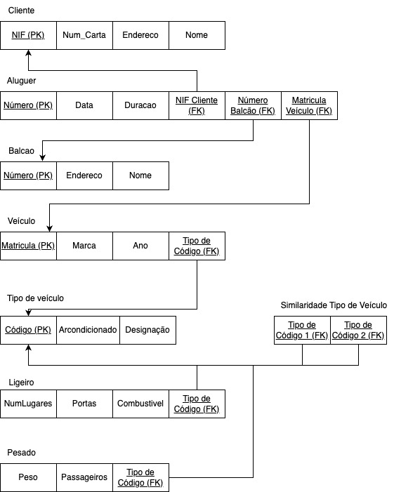
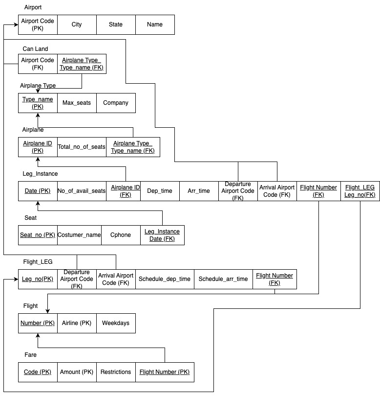
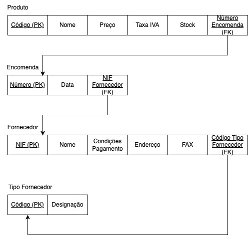
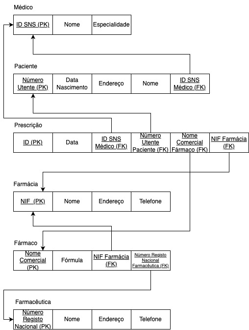
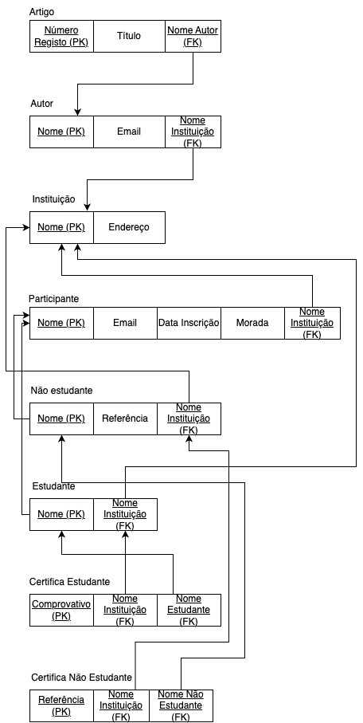
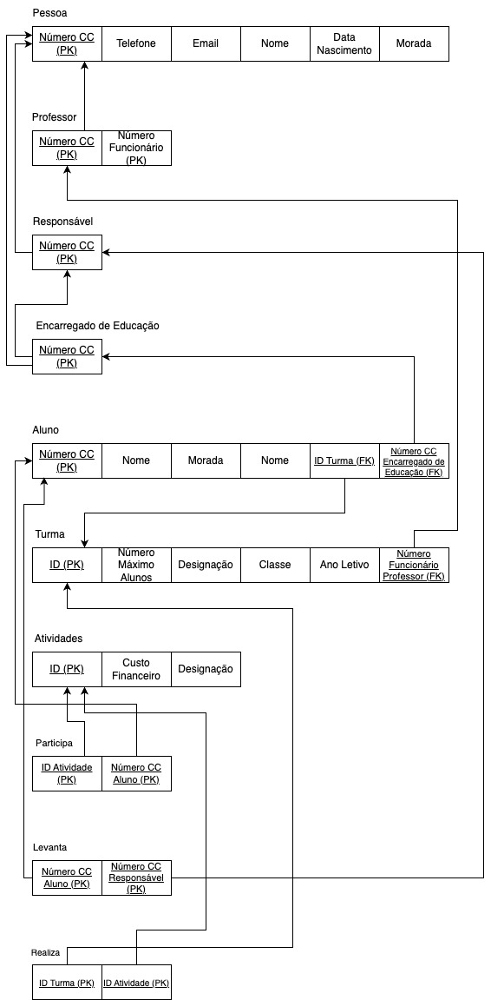

# BD: Guião 3


## ​Problema 3.1
 
### *a)*

```
Um cliente, que é inicialmente identificado pelo seu NIF, pode realizar diferentes alugueres de veículos e é distinguível de outros através do seu número. Estes podem ser realizados num balcão (também caracterizado por um número). Cada um destes veículos, que são identificados por uma matrícula, têm um tipo (identificado por um código): ligeiro ou pesado. Cada um dos veículos do mesmo tipo tem ainda um grau de similaridade com outros veículos do mesmo tipo.
Esquema de Relação:
    - Cliente (NIF, Num_Carta, Endereço, Nome)
    - Aluguer (Número, Data, Duração)
    - Balcão (Número, Endereço, Nome)
    - Veículo (Matrícula, Marca, Ano)
    - Tipo de Veículo (Código, Ar-Condicionado, Designação)
    - Ligeiro (Num_Lugares, Portas, Combustível)
    - Pesado (Peso, Passageiros)
    - Similaridade de Tipo de Veículo (Tipo de Código 1, Tipo de Código 2)

```


### *b)* 

```
Chaves candidatas:
	- Cliente: NIF, Num_Carta
	- Aluguer: Número
	- Balcão: Número
	- Veículo: Matrícula
	- Tipo de veículo: Código
Chaves Primárias:
	- Cliente: NIF
	- Aluguer: Número
	- Balcão: Número
	- Veículo: Matrícula
	- Tipo de veículo: Código
Chaves Estrangeiras:
	- Aluguer: NIF Cliente, Número do Balcão, Matrícula do Veículo
	- Veículo: Tipo de Código
	- Ligeiro: Tipo de Código
	- Pesado: Tipo de Código
	- Similaridade de Tipo de Veículo: Tipo de Código

```


### *c)* 




## ​Problema 3.2

### *a)*

```
Um avião é identificado pelo seu ID e pode ter várias LEG_INSTANCE. Esta por si só poderá ter apenas um avião associado. Cada LEG_INSTANCE é uma instância de FLIGHT_LEG, ao qual a mesma só poderá estar associada a um único voo. Cada voo é identificado pelo seu número e pode ter diferentes tipos de fare. Cada aeroporto, que é identificado por um código pode receber vários tipos de aviões (opera tanto chegadas como partidas).

Esquema de Relação:
    - AIRPORT (Airport code, City, State, Name)
    - AIRPLANE_TYPE (Type_name, Company, Max_seats)
    - AIRPLANE (Airplane_ID, Total_no_of_seats, AIRPLANE_TYPE.Type_name)
    - SEAT (Seat_no, Customer_name, Cphone, LEG_INSTANCE.Date)
    - LEG_INSTANCE (Date, No_of_avail_seats, AIRPLANE.Airplane_ID, Dep_time, Arr_time, Departe AIRPORT.Code, Arrival AIRPORT.Code, FLIGHT.Number, FLIGHT_LEG.no)
    - FARE (Restrictions, Amount, Code, FLIGHT.Number)
    - FLIGHT (Number, Airline, Weekdays)
    - FLIGHT_LEG (Leg_no, Departe AIRPORT.Code, Arrival AIRPORT.Code, Schedule_dep_time, Schedule_arr_time, FLIGHT.Number)
    - CAN_LAND (AIRPORT.Airport_code, AIRPLANE.Type_name)

```


### *b)* 

```
Chaves candidatas:
	-  AIRPORT: Airport_code
	- AIRPLANE_TYPE: Type_name
	- AIRPLANE: Airplane_ID
	- SEAT: Seat_no
    - LEG_INSTANCE: Date
    - FARE: Code, Amount
    - FLIGHT: Number, Airline
    - FLIGHT_LEG: Leg_no
    - CAN_LAND: AIRPORT.Airport_code, AIRPLANE.Type_name
Chaves Primárias:
	-  AIRPORT: Airport_code
	- AIRPLANE_TYPE: Type_name
	- AIRPLANE: Airplane_ID
	- SEAT: Seat_no
    - LEG_INSTANCE: Date
    - FARE: Code
    - FLIGHT: Number
    - FLIGHT_LEG: Leg_no
Chaves Estrangeiras:
	- AIRPLANE: Airplane_TYPE.Type_name
	- SEAT: LEG_INSTANCE.Date
    - LEG_INSTANCE: AIRPLANE.Airplane_ID, FLIGHT.Number, FLIGHT_LEG_no
    - FARE: FLIGHT.Number
    - FLIGHT_LEG: AIRPORT.Airport_Code, FLIGHT.Number
    - CAN_LAND: AIRPORT.Airport_code, AIRPLANE.Type_name

```


### *c)* 




## ​Problema 3.3


### *a)* 2.1



### *b)* 2.2



### *c)* 2.3



### *d)* 2.4

